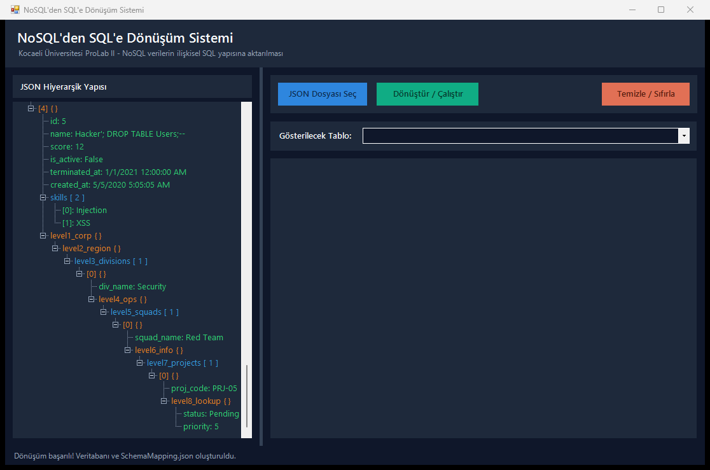
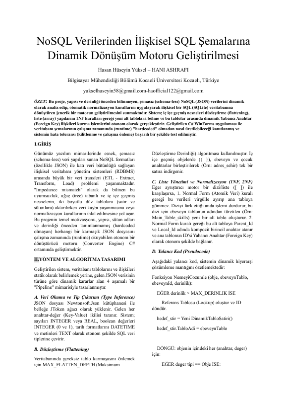
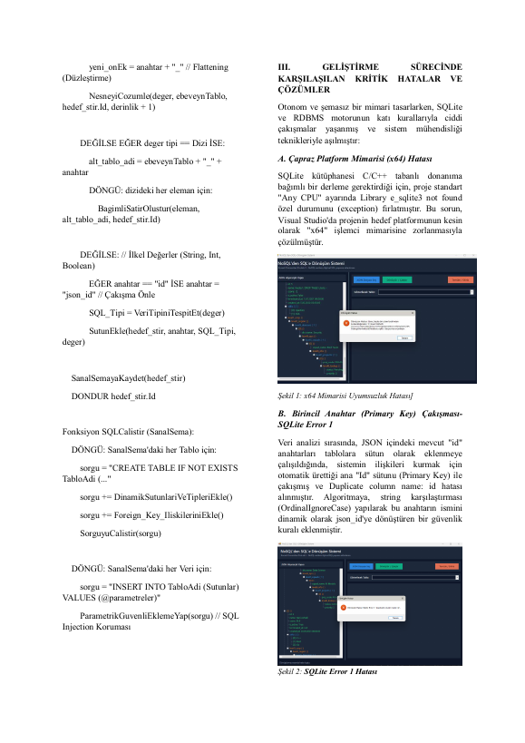
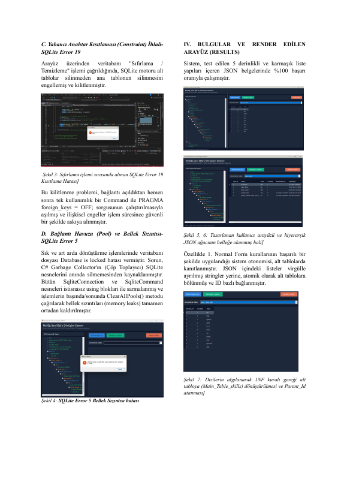
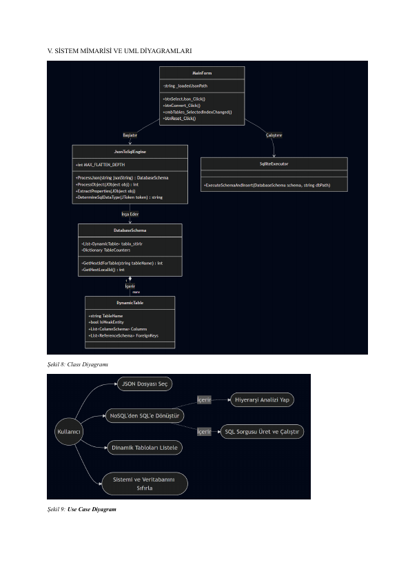
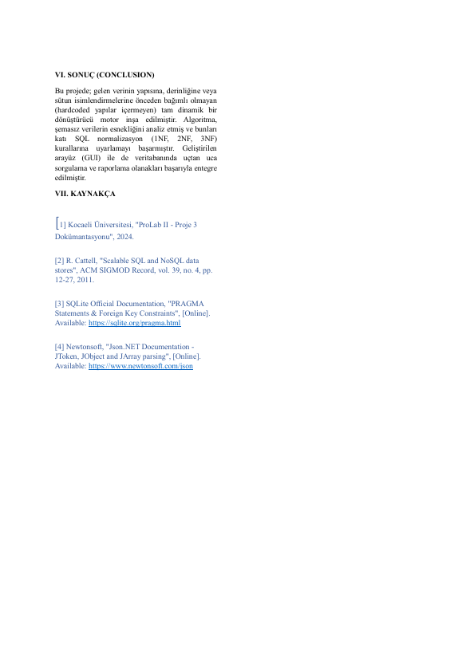

# Dynamic JSON to relational SQL converter (C#, WinForms)

Turns schema-less JSON documents into a relational SQLite schema without knowing their shape in advance.

## Context

Coursework for the Programming Laboratory (Prolab) course, Computer Engineering, Kocaeli University - Spring 2026, project 3.

## What it does

- Walks nested JSON objects and arrays and infers tables, columns and SQL types
- Creates parent/child tables with foreign keys
- Windows Forms front end (`MainForm`) with a sample `input_data.json`

## Build / run

Open `DynamicJsonToSql.sln` in Visual Studio (x64), restore NuGet packages (Microsoft.Data.Sqlite, Newtonsoft.Json) and run.

Command line:

```
nuget restore DynamicJsonToSql.sln
msbuild DynamicJsonToSql/DynamicJsonToSql.csproj /p:Configuration=Release /p:Platform=x64
```

## Report

The full project report (PDF) is in `docs/report.pdf`.

## Notes

No API keys, tokens or credentials are used or stored in this repository.

## Screenshot



Built and run with MSBuild (x64): the sample `input_data.json` converts into `NormalizedDatabase.sqlite` plus `SchemaMapping.json`. The csproj now references `netstandard`, which the SQLite packages need on .NET Framework 4.7.2.

## Report pages

Full report: [docs/report.pdf](docs/report.pdf)






